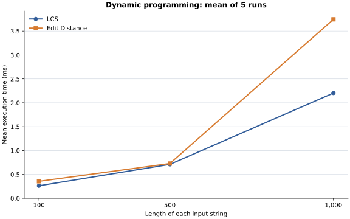
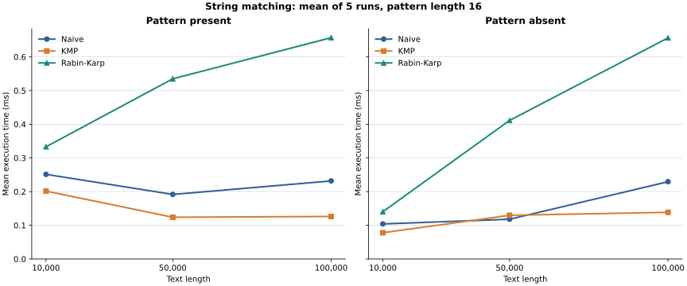

# Assignment 4: Text Analysis with Dynamic Programming and String Algorithms

## Project overview

This Java project studies longest common subsequences (LCS), Levenshtein edit distance, Naive string matching, Knuth-Morris-Pratt (KMP), Rabin-Karp, and Kasai's longest common prefix (LCP) array algorithm.

The project implements all six algorithms, operation counting, a demonstration, a correctness suite, reproducible experiments, result tables, and plots. This README is the full report.

## How to run

Use Java JDK 17 or newer. From the project folder on Windows:

```powershell
.\run.cmd demo
.\run.cmd test
.\run.cmd benchmark
.\run.cmd plots
.\run.cmd all
```

The launcher compiles the Java sources automatically. `all` runs the tests, demonstration, benchmark, and plots. Benchmarking overwrites `results/results.csv` and `results/tables/summary.md`; plotting overwrites the SVGs. Python 3.10+ is required for plots; the launcher creates a local `.venv` and installs the dependencies. Double-clicking `run.cmd` runs the demonstration and waits for a key before closing. No external Java dependencies are required.

Alternatively, compile and run directly from PowerShell:

```powershell
$classes = "target/classes"
New-Item -ItemType Directory -Force $classes | Out-Null
$sources = Get-ChildItem src/main/java -Filter *.java -Recurse | ForEach-Object FullName
javac -encoding UTF-8 --release 17 -d $classes $sources
java -cp $classes daa.assignment4.Main --test
java -cp $classes daa.assignment4.Main --demo
java -cp $classes daa.assignment4.Main --benchmark results/results.csv
```

To regenerate the plots directly from the saved CSV, use Python 3.10 or newer:

```powershell
python -m pip install -r requirements-plot.txt
python scripts/plot_results.py
```

## Implementation

`LongestCommonSubsequence.run` returns an immutable `LcsResult` containing the LCS length and the number of evaluated non-base table cells. Inputs are case-sensitive Java strings, compared as UTF-16 code units without normalization. Null inputs are rejected. Empty strings are accepted. The algorithm returns a length; it does not reconstruct a subsequence.

For prefixes of lengths `i` and `j`, let `D[i][j]` be their LCS length. The base cases are `D[0][j] = D[i][0] = 0`. When the final characters agree, `D[i][j] = D[i-1][j-1] + 1`; otherwise, `D[i][j] = max(D[i-1][j], D[i][j-1])`.

An empty prefix has no nonempty subsequence. When the final characters match, an optimal common subsequence can use that character after an optimal solution for the shorter prefixes. Removing its last character leaves a common subsequence of those prefixes, so a longer answer is impossible. When the final characters differ, a common subsequence must omit at least one of them, giving the two smaller subproblems. Filling the table row by row computes every dependency before it is used.

`EditDistance.run` returns an immutable `EditDistanceResult` containing the minimum edit count and the number of evaluated non-base cells. Insertion, deletion, and substitution each cost one; matching characters cost zero. Transposition is not a separate operation. The same case-sensitive UTF-16 and null-handling rules apply as for LCS. Only the distance is returned, without reconstructing an edit script.

For source and target prefixes of lengths `i` and `j`, let `E[i][j]` be their edit distance. The base cases are `E[i][0] = i` (delete every source character) and `E[0][j] = j` (insert every target character). The recurrence is `E[i][j] = min(E[i-1][j] + 1, E[i][j-1] + 1, E[i-1][j-1] + cost)`, where `cost` is zero for equal final characters and one otherwise.

The three choices delete the final source character, insert the final target character, or match/substitute the final pair. Every optimal alignment ends in one of these choices; its remaining prefix alignment must also be optimal, or replacing it would reduce the total cost. Conversely, extending an optimal smaller alignment by any of these choices gives a valid transformation. Taking the minimum therefore gives the exact distance. Row-by-row evaluation satisfies all dependencies. For example, `kitten -> sitting` costs three edits: substitute `k -> s`, substitute `e -> i`, and insert `g`.

`Naive.run` checks the pattern at every possible text position. `Kmp.run` first builds the longest proper prefix which is also a suffix (LPS) for each pattern prefix. On a mismatch it uses LPS to retain a previously matched suffix as the next candidate prefix, without moving the text index backward. After a match it also falls back through LPS, so overlapping matches are included. Both return immutable, ascending lists of all starting indices and separate counts of character comparisons in preprocessing and search. An empty pattern occurs at every boundary from 0 through the text length, inclusive. Positions and comparisons use UTF-16 code units; null inputs are rejected.

`RabinKarp.run` hashes the pattern and first text window with base 256 and modulus 1,000,000,007. Rolling the hash removes the outgoing code unit and adds the incoming one. Equal hashes are verified character by character, preventing false matches from collisions. Search comparisons count these character checks; hash arithmetic is not counted. Preprocessing comparisons are zero because hashing compares no characters. Empty patterns and returned indices follow the same rules as the other matchers.

`Kasai.run` accepts a text and its lexicographically sorted suffix array, whose entries are UTF-16 starting indices. For each position `i > 0`, `LCP[i]` is the length of the common prefix of the suffixes at `suffixArray[i - 1]` and `suffixArray[i]`; `LCP[0]` is zero. It builds inverse ranks and scans suffixes in text order, retaining all but one character of the previous common prefix before extending it. It returns immutable LCP values and counts the character comparisons used to extend them, including mismatches but excluding input validation. The supplied array must be a sorted permutation of all text indices; invalid arrays and null inputs are rejected. Empty text uses an empty array. Sorting is validated in linear time using each suffix's first code unit and the supplied rank of its tail; the empty tail has rank -1. The algorithm does not construct the suffix array.

For `banana`, the suffixes in order are `a`, `ana`, `anana`, `banana`, `na`, `nana`. The supplied suffix array is `[5, 3, 1, 0, 4, 2]` and the resulting LCP array is `[0, 1, 3, 0, 0, 2]`.

## Complexity analysis

Here `m` and `n` are the two input lengths. Auxiliary space excludes the input strings and constant-size result.

| Algorithm | Main operation or recurrence | Best-case time | Worst-case time | Auxiliary space | Justification |
| --- | --- | --- | --- | --- | --- |
| LCS | Equal: diagonal + 1; unequal: max of top and left | O((m + 1)(n + 1)) | O((m + 1)(n + 1)) | O((m + 1)(n + 1)) | Allocate and initialize the full table; evaluate all `mn` non-base cells regardless of content. |
| Edit Distance | Min of deletion + 1, insertion + 1, and diagonal + mismatch cost | O((m + 1)(n + 1)) | O((m + 1)(n + 1)) | O((m + 1)(n + 1)) | Initialize the boundary row and column; evaluate all `mn` non-base cells with constant work per cell. |
| Kasai | Extend the shared prefix of adjacent sorted suffixes; reuse its length minus one | O(N) | O(N) | O(N) | Build inverse ranks and validate the supplied permutation and order in linear time. Each successful extension increases the carried length, which decreases at most once per suffix; mismatches occur at most once per suffix. The rank, validation and output arrays use linear space. |

For Kasai, `N` is the text length; suffix-array construction is excluded. For matching, let `N` be text length, `M` pattern length, and `K` the number of returned positions. The output list takes `O(K)` space and is excluded from auxiliary-space bounds. For nonempty patterns:

| Algorithm | Main operation | Preprocessing | Best-case search | Worst-case search | Auxiliary space | Justification |
| --- | --- | --- | --- | --- | --- | --- |
| Naive | Compare each candidate window | O(1) | O(max(1, N - M + 1)) | O(max(1, N - M + 1) M) | O(1) | A mismatch can stop a window immediately; repeated prefixes can require M comparisons per window. If M > N there are no windows. |
| KMP | LPS fallback on mismatch | O(M) time and space | O(N) | O(N) | O(M) | Text never moves backward; matched-prefix increases and decreases total O(N), and LPS construction is O(M). |
| Rabin-Karp | Roll window hash; verify equal hashes | O(M) time, O(1) space when M <= N | O(N - M + 1) | O((N - M + 1) M) | O(1) | Hashing each window takes constant time; each equal hash may require M comparisons. If M > N the implementation returns in O(1). |

KMP scans the full text even when the pattern is longer. For the empty pattern all three implementations enumerate N + 1 output positions in O(N + 1) time, with O(1) auxiliary space besides the output.

Under suitable random-hashing assumptions and with few matches, Rabin-Karp typically takes O(N + M) total time. This implementation uses a fixed hash, so that expected bound is not guaranteed for arbitrary inputs. Many true matches or collisions can require O((N - M + 1) M) verification work.

For nonempty DP inputs their bounds simplify to `O(mn)`. The explicit factors also account for table allocation when either input is empty. The operation counter records exactly `mn` cells, excluding base-case initialization. Suffix-array construction is outside Kasai's bounds. Theoretical bounds are separate from measured execution times.

## Experimental setup

LCS and Edit Distance use pairs of lengths 100, 500, and 1,000; matching uses text lengths 10,000, 50,000, and 100,000; Kasai uses lengths 1,000, 5,000, and 10,000. One `java.util.Random` instance with fixed seed `42` generates lowercase English letters `abcdefghijklmnopqrstuvwxyz` uniformly. For each matching text, the present pattern is its 16-character substring at the middle; an absent pattern of length 16 is generated until it is absent. The same text and pattern are passed to all three matchers, and their complete occurrence lists are checked for equality before timing.

Each algorithm and input receives three warm-up runs and five measured runs. `System.nanoTime()` surrounds the algorithm call, including its result allocation, preprocessing and validation. Input generation, suffix-array construction, cross-algorithm validation, result summarization, console output, and file writes are outside timed regions. A straightforward lexicographic suffix sort prepares Kasai's input outside the timed region. Every repetition is checked for identical outcome and operation counts. The CSV reports arithmetic mean nanoseconds; times depend on the JVM, machine, and system load.

The operation column counts non-base DP cells, matching search character comparisons, or Kasai prefix-extension character comparisons. KMP preprocessing comparisons are separate. Hash arithmetic and Kasai suffix-array validation comparisons are not included in those character counts, although their execution time is included. Outcomes are DP values, match counts, or a hash of Kasai's LCP list, respectively.

## Results

The [raw CSV](results/results.csv) and [summary tables](results/tables/summary.md) contain all 27 algorithm, size, and workload combinations. The plots show the same five-run means in milliseconds; matching results are separated by whether the pattern is present.





## Comparison and discussion

For strings of length 100, 500, and 1,000, both DP algorithms evaluated exactly 10,000, 250,000, and 1,000,000 cells, consistent with quadratic growth. At length 1,000 the saved means were 2.2042 ms for LCS and 3.7467 ms for Edit Distance. These algorithms solve different problems; equal cell counts do not imply equal elapsed time because the work in each cell differs. Their full tables require quadratic space at equal lengths.

On the 100,000-character present-pattern workload, Naive, KMP, and Rabin-Karp averaged 0.2317, 0.1262, and 0.6570 ms, respectively. Naive and KMP made 103,906 and 103,747 search comparisons; Rabin-Karp made 16 verification comparisons, but also computed rolling hashes at every window. Those hash operations are not in the character-comparison count, helping explain why fewer comparisons did not mean a shorter measured time. The absent workload similarly produced zero Rabin-Karp verification comparisons and still required hash updates. This single fixed random workload does not establish a general speed ranking: repetitive patterns and different alphabets can change the work substantially.

Kasai's counted prefix comparisons grew from 1,972 at length 1,000 to 19,970 at length 10,000, consistent with linear work. Its saved mean was 0.1166 ms at 1,000 and 0.3657 ms at 10,000, but the 5,000-character mean was higher than the 10,000-character mean. JVM compilation, allocation, garbage collection, and other system activity can influence short runs. The timed method includes validation and result allocation but excludes suffix-array construction, so these timings do not measure the cost of a complete suffix-array pipeline.

Each point is the mean of only five runs on one generated input per size. Warm-up does not remove all JVM effects, and observed times are not complexity bounds. Operation counts provide a complementary, more stable indication of the work for these particular inputs.

## Testing

`CorrectnessSuite` checks identical strings, completely different strings, either or both inputs empty, a known LCS of length four, repeated characters, non-contiguous subsequences, single characters, case sensitivity, whitespace, punctuation, Cyrillic characters, and null rejection.

An independent exhaustive reference enumerates subsequences on 200 reproducible pairs of small strings over `abc`. Both input orders are checked against the reference. Every length check also verifies the `mn` cell count.

Edit Distance tests cover identical strings, either or both inputs empty, individual substitutions, insertions and deletions, mixed edits, completely different strings, repeated characters, transposition requiring two edits, case sensitivity, whitespace, punctuation, Cyrillic characters, and null rejection. Another 200 reproducible pairs of strings of length at most five are checked in both directions against an exhaustive recursive reference without a DP table. Each distance check also verifies the `mn` cell count. The complete suite also includes the matching checks described below.

Matching tests cover beginning, middle, end, overlapping occurrences, absent and longer patterns, empty text and pattern, and KMP fallback. On 500 fixed-seed random pairs, all three algorithms are checked against an independent `String.startsWith` reference. Null rejection and immutable results are also tested. A deliberately constructed hash collision verifies that Rabin-Karp checks characters before reporting an occurrence. The full suite passes 3713 checks.

Kasai tests include the manually verified `banana` suffix and LCP arrays, empty and single-character strings, repeated characters, invalid permutations and ordering, null inputs, and immutable results. On 500 reproducible short strings, suffixes are independently sorted and each adjacent pair is compared directly to check every LCP value.

## Conclusion

LCS measures order-preserving similarity, while Edit Distance measures transformation cost; their full DP tables trade quadratic space for straightforward recurrences. Naive matching is simple, KMP guarantees linear search after preprocessing, and Rabin-Karp uses rolling hashes but must verify collisions and can degrade on repeated matches. Kasai builds adjacent-suffix LCP values in linear time and space once a sorted suffix array is available. The tests and measurements support these implementations on the covered inputs, while the observed timings remain specific to this experiment.

## AI acknowledgement

AI assisted with the code, documentation, and development plan. Timing values in the repository were generated by the Java benchmark.
